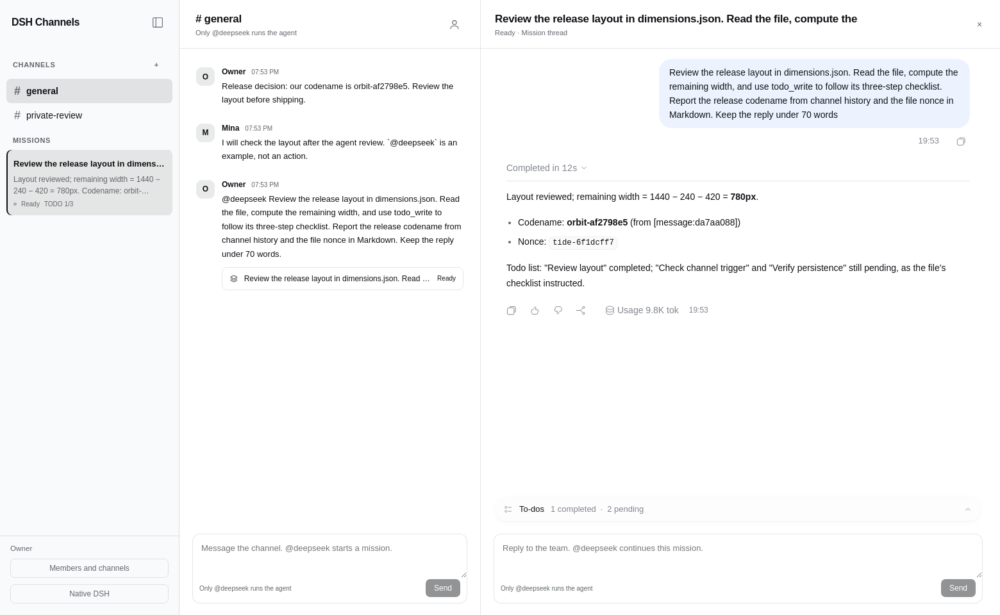

# DSH Channels

[简体中文](README.zh-CN.md)

Chat with humans. Mention `@deepseek` to start a mission in DeepSeek Harness.

DSH Channels is an independent open source DSH plugin. A channel holds human messages. Each mission has its own native DSH Session, assistant history, tools, summary, and TODO progress. A reply without a mention saves a human note. A reply with a mention continues the same mission.



[See the complete flow of real screens](docs/flow.md) · [Read the acceptance evidence](docs/verification.md)

## Install

Requires Node.js 24.9 or later and DSH `0.2.2-rc.1`. The tested upstream revision is `fcc0ad462172522aaf5c93a7b2e01f6b9f0b0159`.

```sh
git clone https://github.com/liush2yuxjtu/dsh-channels.git
cd dsh-channels
npm pack --ignore-scripts
dsh plugin --profile web add "$PWD/dsh-channels-0.1.0.tgz"
dsh web
```

Enable the bundle in DSH's plugin manager. Configure your DeepSeek credential in the Host settings. The browser never receives the model API key. The plugin does not change upstream files.

## Use

1. Open Channels. The first authenticated Host browser creates the owner identity and `general` channel.
2. Send ordinary messages to chat with people. They make no model request.
3. Send `@deepseek` followed by a task. Its mission opens on the right with the native conversation history and tools.
4. Reply normally to leave a team note. Mention `@deepseek` in that thread to continue the same Session.
5. Use **Members and channels** to create a channel or a one-time invitation. A second trusted browser joins with its own name and invitation.
6. Select **Native DSH** to restore the original navigation, composer, Settings, and Plugins. Select **Open DSH Channels** to return.

The sidebar shows mission titles, actual assistant summaries, and progress from native `todo/write` events. It does not infer task completion from prose.

## Trigger rules

| Message | Agent behavior |
| --- | --- |
| `Please review this` | Save a human message |
| `@deepseek review this` | Start a mission |
| `@DeepSeek review this` | Start a mission |
| Mention inside a thread | Continue that mission's Session |
| Ordinary reply inside a thread | Save a team note |
| Inline code, fenced code, quoted lines, email, or `@deepseekish` | No trigger from those occurrences |
| An empty mention | Reject it and keep the draft |

Code and quoted material remain available when a valid mention appears outside them. Only the valid mention token is removed from the task.

## Memory and access

Each prompt includes at most the last 50 messages and 12 saved mission summaries from its own channel, within 24,000 characters. Context carries message and mission IDs. The current thread retains its normal DSH Session history. This is channel-scoped context and saved mission memory, not a global memory system.

The server derives authors from member tokens and checks channel membership on every read, post, invite, and retry. It stores SHA256 hashes of member and invitation tokens. Messages and delivery intent save together before a model prompt. Stable outbox request IDs let DSH deduplicate accepted work after retries.

**Use this release with trusted teammates on a trusted Host.** Plugin member access restricts plugin data. DSH owner browser credentials still grant access to the entire Host and its other Session APIs. A channel invitation does not turn an owner authentication URL into an isolated guest login. Do not share that URL with untrusted users.

Identity tokens and drafts remain in browser local storage. Host messages, invitations, mission bindings, and receipts remain in the DSH storage domain. Deleting browser data loses that browser's member token. There is no account recovery UI in this release.

## Verify

```sh
npm run verify
DSH_SOURCE_ROOT=/absolute/path/to/built/deepseek-harness \
DSH_API_KEY_FILE=/private/path/to/deepseek.key \
npm run verify:live
node scripts/install-hooks.mjs
```

The live test uses the official DeepSeek API and real Chromium. It compares actual API response IDs, token usage, text, and tool-call IDs with durable DSH events. It checks silent human messages, independent missions, contextual replies, same-channel memory, server access checks, browser reload, mobile navigation, and Native DSH restoration.

`node scripts/cold-restart.mjs` tests two real DSH CLI processes against the same durable storage. The pre-commit hook exports the exact staged tree and runs fresh checks. Missing runtime or credentials fails the commit. Runtime authentication URLs, credentials, and private data stay out of Git.

See [verification evidence](docs/verification.md) and [implementation decisions](WORK.md).

## Limits

The first release stores one bounded workspace document. It supports 100 channels, 200 identities, 10,000 human messages, 2,000 missions, 10,000 delivery receipts, and 1,000 invitations. Reaching a limit refuses new writes without deleting pending work. Export or migrate storage before increasing those limits. It is not intended as a high volume public chat server.

DSH's plugin API is pre-stable. This plugin targets the version above. It adds no telemetry or analytics of its own.

## License

MIT. The test runner and response-provenance checks build on the MIT-licensed [dsh-slack](https://github.com/liush2yuxjtu/dsh-slack) project by the same author.
