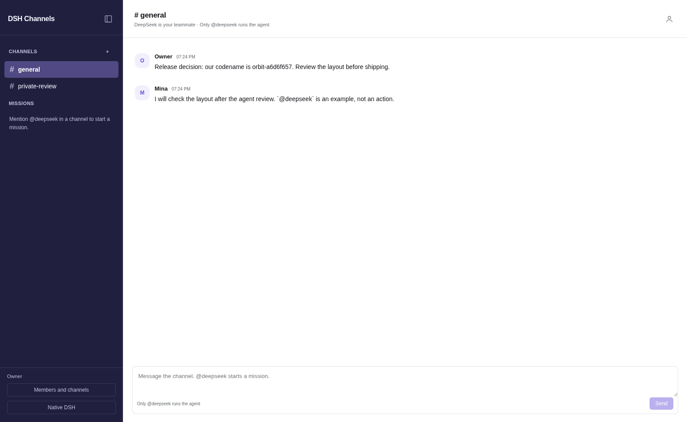
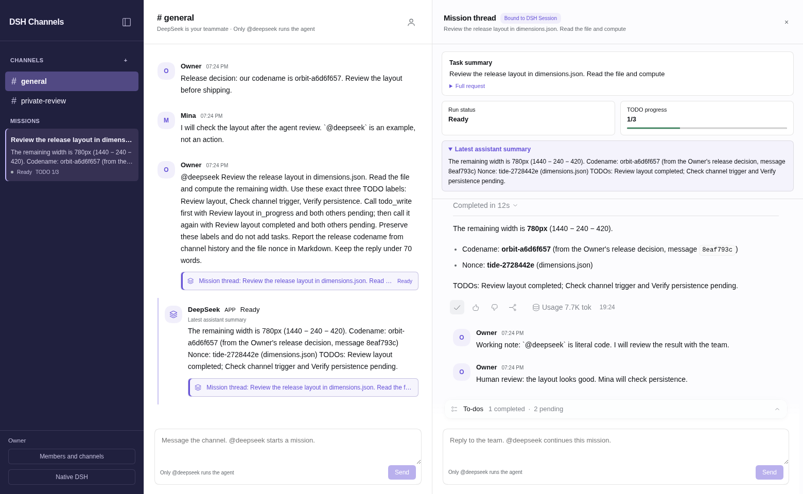
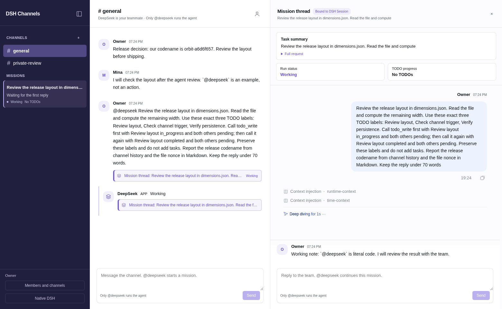
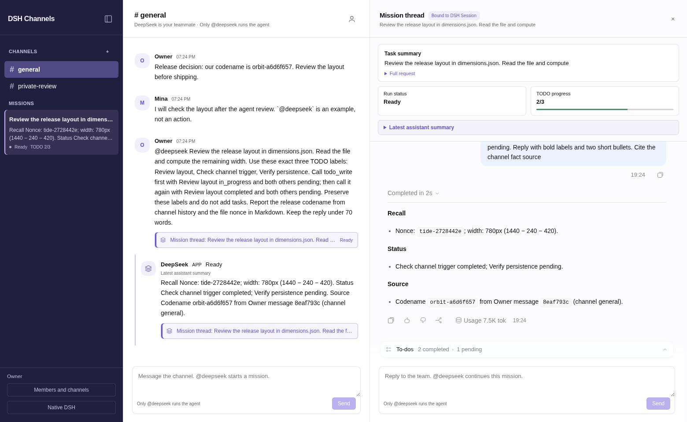
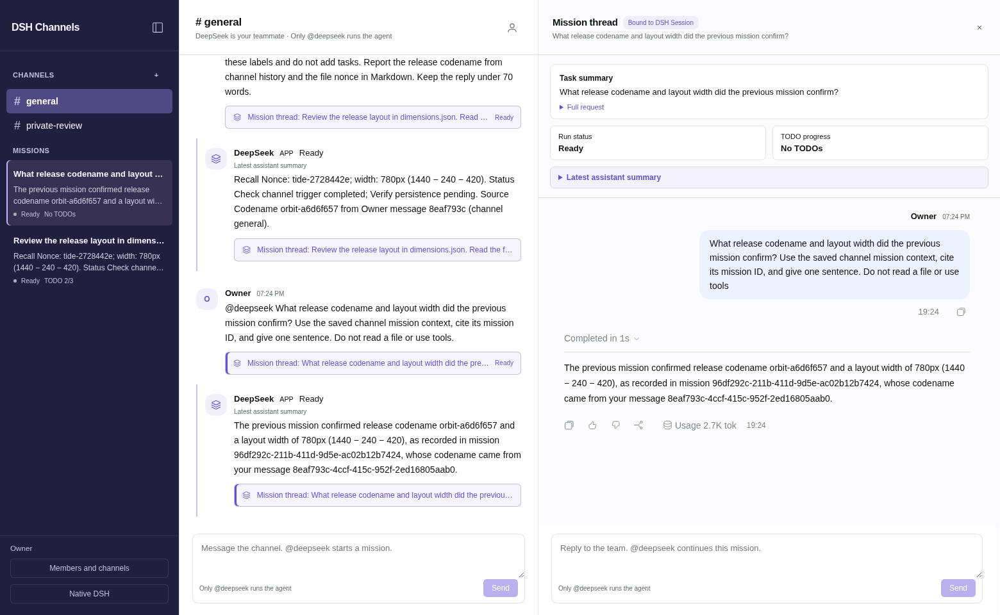
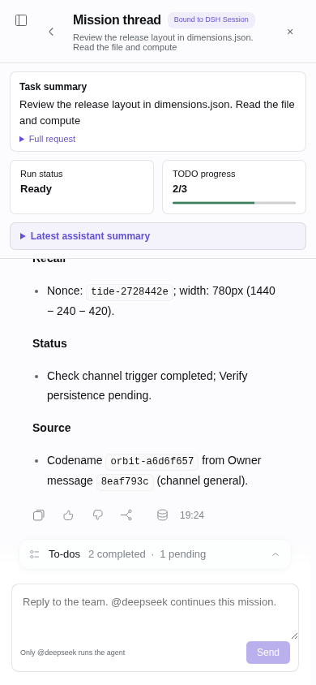
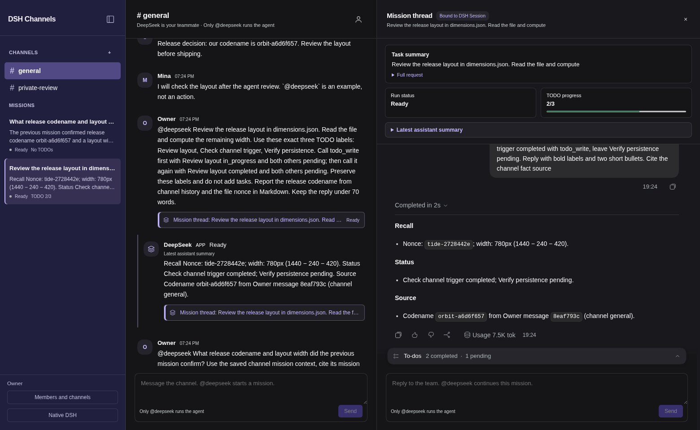
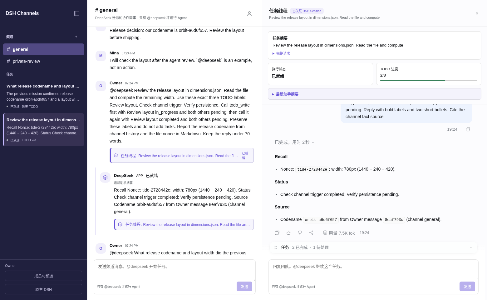

# Real workflow

These are unedited 0.1.1 screenshots from real Chromium running the external plugin in DSH on 2026-11-15. Assistant replies and TODOs came from the official DeepSeek API.

## 1 Chat with people

Two browser identities share channel messages. Ordinary messages make zero model calls.

## 2 Mention the agent

An explicit `@deepseek` creates one native Session. The mission card shows the actual assistant summary and TODO progress.

While the model is working, ordinary human comments remain visible above the reply box without starting another model turn.

## 3 Continue the mission

A human note stays silent. A mention continues the original Session and updates the same TODO list.

## 4 Start a new mission with channel memory

A separate Session recalls a confirmed result from the earlier mission in the same channel.

## Phone and dark mode

## Chinese interface

[Verification evidence](verification.md)
