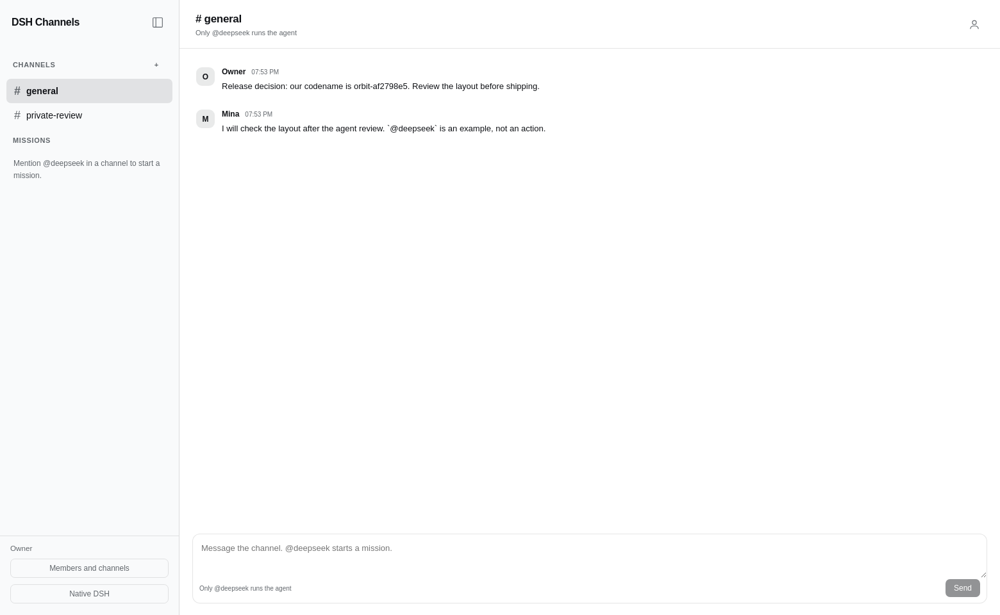
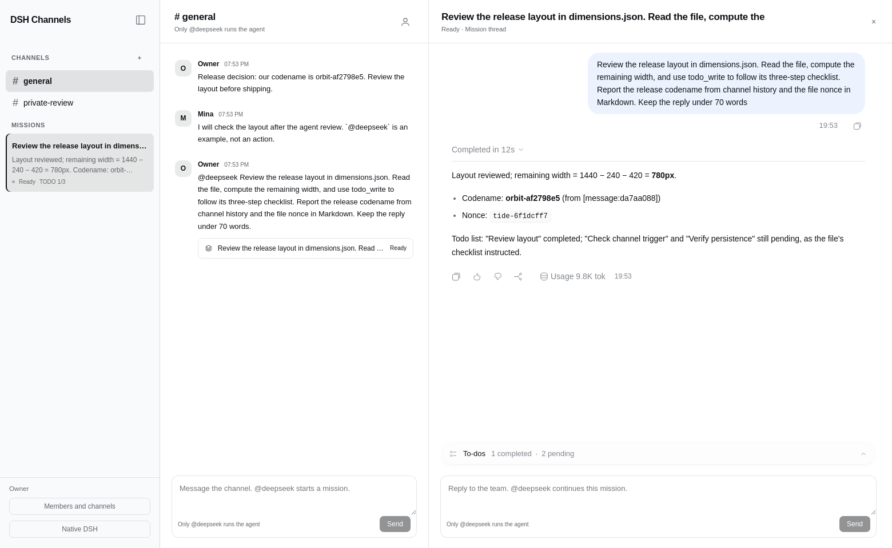
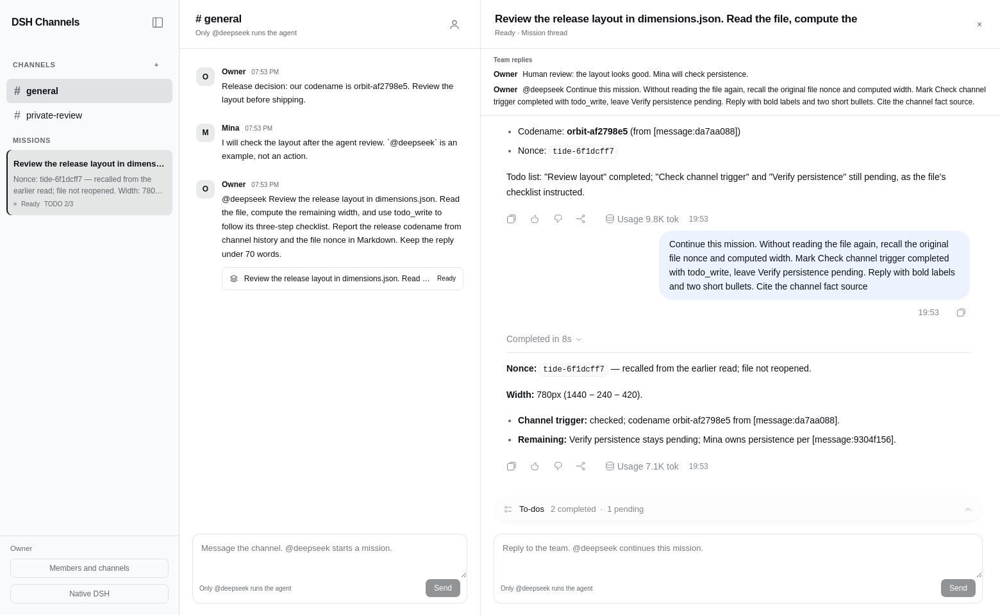
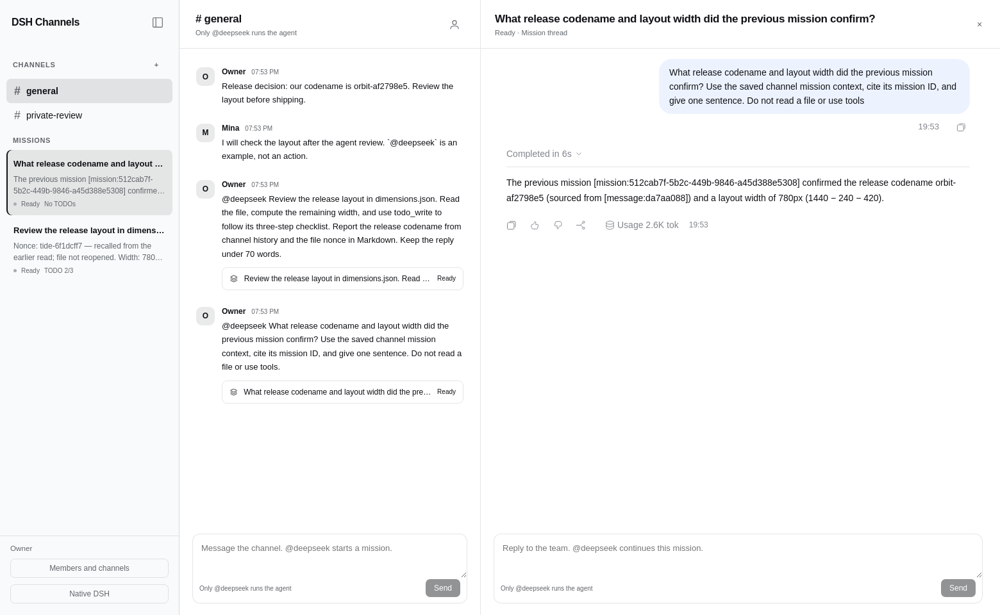
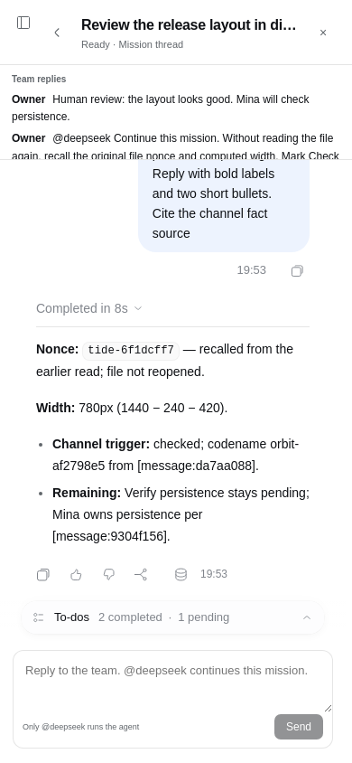
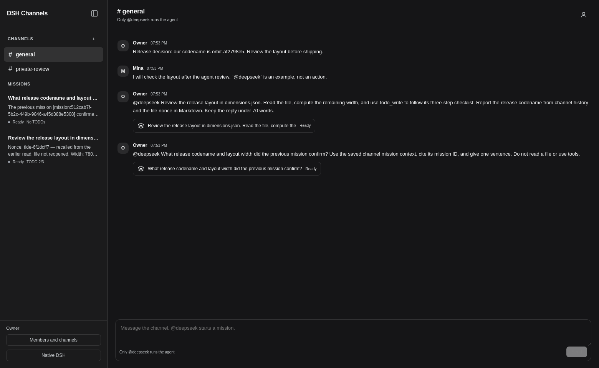

# Real workflow

These are unedited screenshots from real Chromium running the external plugin in DSH. Assistant replies and TODOs came from the official DeepSeek API.

## 1 Chat with people

Two browser identities share channel messages. Ordinary messages make zero model calls.

## 2 Mention the agent

An explicit `@deepseek` creates one native Session. The mission card shows the actual assistant summary and TODO progress.

## 3 Continue the mission

A human note stays silent. A mention continues the original Session and updates the same TODO list.

## 4 Start a new mission with channel memory

A separate Session recalls a confirmed result from the earlier mission in the same channel.

## Phone and dark mode

[Verification evidence](verification.md)
